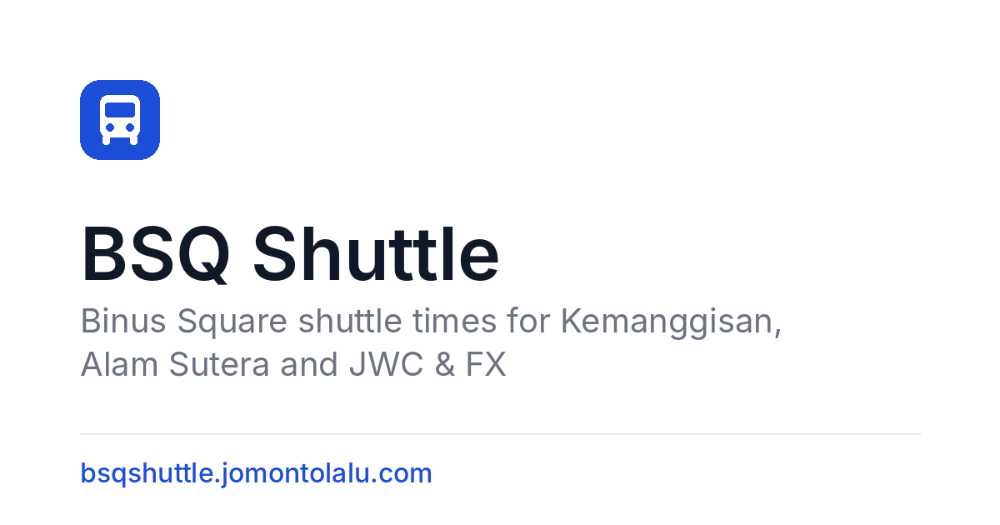
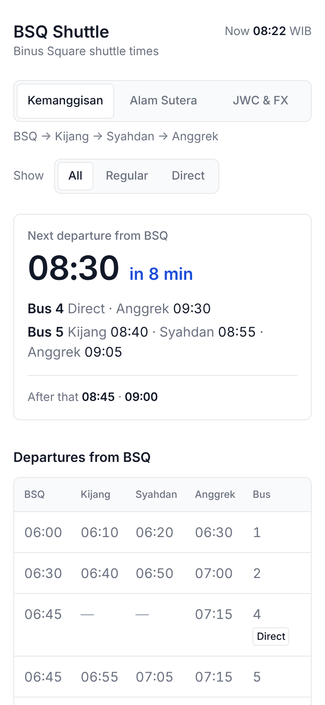
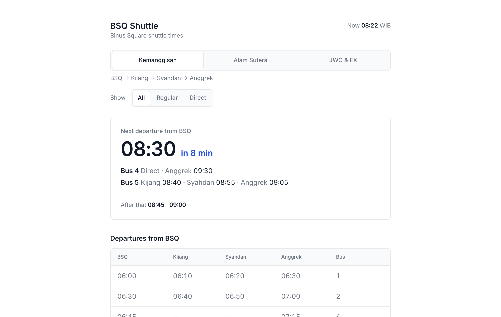

<div align="center">



<br>

**When does the next shuttle leave Binus Square?** Open the page and you'll see it straight away.

[](https://bsqshuttle.jomontolalu.com/)


[**Open the app →**](https://bsqshuttle.jomontolalu.com/)

</div>

<br>

## Preview

<table>
  <tr>
    <td width="32%" valign="top"></td>
    <td width="68%" valign="top"></td>
  </tr>
  <tr>
    <td align="center"><sub>Phone</sub></td>
    <td align="center"><sub>Desktop</sub></td>
  </tr>
</table>

<br>

## What it does

| Feature | Why it matters |
|---|---|
| **Next departure, with a countdown** | One look tells you "08:30, in 8 min". No hunting through a table. |
| **Every bus at that time** | When a regular and a direct bus leave together, both are shown with their stop times. |
| **Full day schedule** | Past departures are greyed out and the next one is highlighted. |
| **Regular / Direct filter** | Only see the buses that stop where you're going. |
| **Always Jakarta time (WIB)** | Correct even if your phone is set to another time zone. |
| **Remembers your route** | Opens on the route you used last. Each route has its own link to share. |
| **Installable and offline** | Add it to your home screen and it opens like an app, even without internet. |

<br>

## Routes

| Route | Stops | Departures a day |
|---|---|:---:|
| **Kemanggisan** | BSQ → Kijang → Syahdan → Anggrek<br><sub>Direct buses go straight to Anggrek</sub> | 26 |
| **Alam Sutera** | BSQ → Alam Sutera (ASO) | 3 |
| **JWC & FX** | BSQ → JWC → FX | 4 |

<br>

## Add it to your home screen

| Phone | Steps |
|---|---|
| **Android** (Chrome) | Open the site → tap **Install app**, or **⋮ → Add to Home screen** |
| **iPhone** (Safari) | Open the site → tap **Share** → **Add to Home Screen** |

After the first visit, it works with no connection.

<br>

## Project structure

```
bsqshuttle/
├── index.html               The whole app: layout, styles, schedule data and logic
├── sw.js                    Offline support (service worker)
├── manifest.webmanifest     App name, colours and icons for installing
├── favicon.svg              Browser tab icon
├── favicon-32.png           Browser tab icon (fallback)
├── apple-touch-icon.png     iPhone home screen icon
├── icon-192.png             Android app icon
├── icon-512.png             Android app icon
├── icon-maskable-512.png    Android adaptive icon
├── og-image.png             Preview image for shared links
├── docs/                    Screenshots for this README
└── README.md
```

No build step, no framework, no packages. One HTML file and a few static assets.

<br>

## Updating the schedule

All times live in the `ROUTES` object near the bottom of `index.html`.

**1. Edit the rows.** Keep each route's rows in time order.

```js
// Kemanggisan — use '--' for stops a direct bus skips
{ bsq: '08:30', kijang: '08:40', syahdan: '08:55', dest: '09:05', bus: 'S5' },
{ bsq: '08:30', kijang: '--',    syahdan: '--',    dest: '09:30', bus: 'S4' },

// Alam Sutera and JWC & FX — tag is optional, leave it '' if not needed
{ bsq: '10:15', dest: '13:30', vehicle: 'Elf', plate: 'B 7993 SDA', tag: 'Skips ASO' },
```

**2. Edit the notes** in the `notes` list of the same route if anything changed.

**3. Bump the version in `sw.js`.** Phones keep a saved copy for offline use, so this tells them to fetch the new one.

```js
const VERSION = 'v2';   // was 'v1'
```

> [!IMPORTANT]
> If you skip step 3, people who installed the app may keep seeing the old times.

<br>

## Run it locally

```bash
# from the project folder
python -m http.server 8000
```

Then open <http://localhost:8000>. Opening `index.html` by double-clicking works too, but offline mode only runs over `http://localhost` or `https://`.

<br>

## Deploy

Upload every file to the **root** of `bsqshuttle.jomontolalu.com`, with `index.html` at the top level.

- The site must be served over **HTTPS** for installing and offline mode to work.
- Don't let your host cache `sw.js` for a long time, or updates reach phones slowly.
- Icon and file paths start with `/`, so the app must live at the domain root, not in a subfolder.

<br>

---

<div align="center">
<sub>
Unofficial student project. Not affiliated with Bina Nusantara.<br>
Times follow the published shuttle schedule and can change without notice.<br><br>
Made by <a href="https://jomontolalu.com/">jomontolalu</a>
</sub>
</div>
